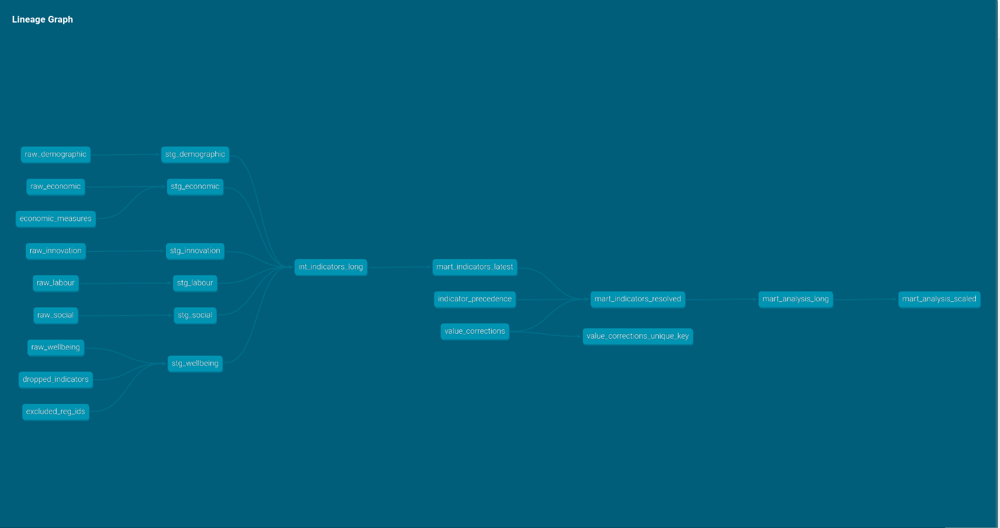

<!--Include academic icons or bottons-->



## Rebuilding a published study as a tested data pipeline

**OECD regional well-being — 388 regions, 135 indicators, one reproduction**

[Repository](https://github.com/LSmantiz/oecd-wellbeing-pipeline) ·
[Read the analysis](docs/python_ml_analysis.html) ·
[Read the robustness study](docs/frontier_comparison.html)

I took the data preparation behind one of [my published papers](../wellbeing-ml/index.qmd) — originally
written in R, later ported to pandas — and rebuilt it as a version-controlled,
tested pipeline: dbt over DuckDB for the transformations, scikit-learn for the
analysis, GitHub Actions running the whole thing in a clean container on every
commit.

The output reproduces the published dataset exactly: 388 regions, 135
indicators, every value identical to floating-point precision.

### What the tests found

Writing the transformations as tested SQL rather than scripts surfaced four
things the original pipeline had resolved silently.

The OECD publishes each series at several territorial levels, and the same
region code can carry different values at different levels. Zeeland appears
twice with two different waste figures — 71 and 78 — describing genuinely
different areas. The original code deduplicated on identifiers while ignoring
the values, so which figure survived depended on row order in the source file.

The obvious fix — keep only the larger territorial level — would have silently
removed five Estonian regions from the analysis, because Estonia publishes them
only at the finer level. No error would have been raised. The rule the pipeline
uses now is a preference with a documented fallback.

The list of country codes to exclude turned out to be missing Latvia and
Lithuania, which had joined the OECD around the time the data was compiled.

None of this changed the published results. It was found because declarative
tests ask precise questions that scripts do not.

### Making an implicit design choice explicit

The analysis requires every indicator to be observed for every region, so a
single poorly-covered region removes that indicator for all of them. That rule
is standard and was applied without examining what it cost.

Sweeping the trade-off shows the cost was substantial and the remedy cheap:
dropping the ten worst-covered regions out of 388 — 2.6% of the sample — would
have made 44 additional indicators available, a third more than the published
analysis used. Almost none of the remaining regions buy anything: the next
seventy dropped gain one indicator between them.

Whether that changes any conclusion is the subject of the second document, which
runs the full analysis at several points along the trade-off and compares which
predictors survive.

### Two methods implemented from source

Accumulated Local Effects and Friedman's H-statistic exist in R's `iml` package
but have no scikit-learn equivalent. Rather than approximate them, I worked from
the R source so the numerical procedure matches — including the parts that are
easy to get wrong, such as how empty cells in a two-dimensional grid are filled
and how main effects are removed from an interaction surface.

Both are verified against structures with known answers: the interaction surface
of an exactly additive model comes out as zero to machine precision, and the
surface for a known product recovers that product.

Those checks produced an incidental result worth carrying into the
interpretation. A random forest fitted on data with *no* interaction still
reports a substantial one — tree ensembles manufacture structure that is not in
the data. This is why the analysis carries two model families through in
parallel: agreement between them is what separates a finding from an artefact.

### Stack

dbt · DuckDB · SQL · Python · scikit-learn · XGBoost · pandas · pytest ·
GitHub Actions · Quarto

